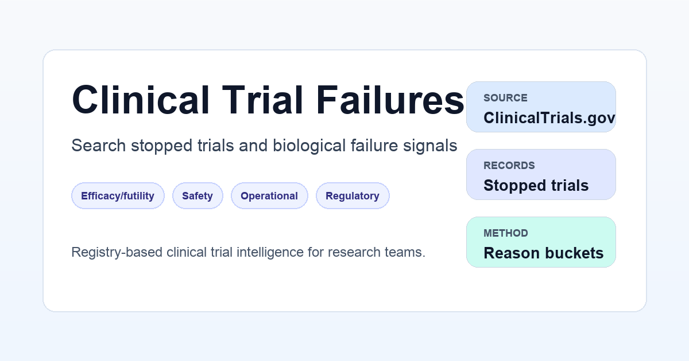

# Clinical Trial Failures

**Has a drug with your target failed before, and did it fail because of the biology?**

This repository builds [clinicaltrialfailures.com](https://clinicaltrialfailures.com), a
searchable dataset of stopped clinical trials. Each trial is classified by why it stopped. The
classification separates biological failure signals (efficacy, futility, safety) from
non-biological ones (recruitment, funding, strategy, regulatory).

## What is in the data

The figures below are from the release of 16 Oct 2026. Every weekly run refreshes them.

| | Trials |
| --- | ---: |
| Stopped trials (terminated, withdrawn, suspended) from ClinicalTrials.gov | 23,941 |
| Biological failure (efficacy, futility, safety, biological unspecified) | 2,434 |
| Mixed causes, at least one of them biological | 257 |
| Non-biological stop (recruitment, funding, business, regulatory, operational) | 14,348 |
| Not a failure (e.g. a planned transition to another study) | 1,292 |
| No cause stated, or routed to review rather than guessed | 5,610 |

Classification quality was checked on a held-out sample of 600 trials, with two blind
annotators. Biological-failure precision was **95.5 %** (95 % CI 91.6–98.7 %) and recall
**95.3 %**. The protocol is in [`docs/validation_heldout_v2.md`](docs/validation_heldout_v2.md).

For completed Phase 2/3 trials, the pipeline also reads the sponsor's own posted primary
comparison. This shows which trials ran to the end and still missed their primary endpoint, a
failure that a stopped-trial count cannot see.

## Use it

- **Search and browse:** [clinicaltrialfailures.com/explore](https://clinicaltrialfailures.com/explore)
- **Check a molecule or target:** [clinicaltrialfailures.com/asset-check](https://clinicaltrialfailures.com/asset-check)
- **Mechanism-class briefs:** [clinicaltrialfailures.com/briefs](https://clinicaltrialfailures.com/briefs)
- **Newly stopped trials every two weeks:** [newsletter](https://clinicaltrialfailures.com/newsletter)
- **Raw files:** the CSV/JSON files in [`data/`](data/)

| File | Content |
| --- | --- |
| `data/all_stopped_trials.csv` / `.json` | Every stopped trial with its classification |
| `data/biological_failure_trials.csv` / `.json` | The subset with a biological failure signal |
| `data/all_oncology_stopped_trials.csv` / `.json` | Oncology stopped trials |
| `data/biological_failure_oncology_trials.csv` / `.json` | Oncology biological failures |
| `data/ingest_changes.json` | What changed since the previous weekly ingest |

Key columns: `nct_id`, `why_stopped` (the sponsor's own text, quoted verbatim),
`classification_final_outcome`, `classification_final_category`, `classification_evidence`
(the span the label rests on), `disease_area`, `phases`, `lead_sponsor`, `intervention_names`,
and `url` (the ClinicalTrials.gov record).

## How the classification works

1. The trial universe is fetched from the [ClinicalTrials.gov API v2](https://clinicaltrials.gov/data-api/api).
2. The sponsor's stop reason is classified with the conservative **Classification V2**
   pipeline. Each label stores the evidence it was read from, outcome and cause are kept
   apart, and novel or content-free language goes to review instead of being forced into a
   bucket. See [`docs/classification_v2.md`](docs/classification_v2.md).
3. Manual decisions and review dispositions are versioned in `data/` and `overrides.csv`.
4. The method and its limits are described at
   [clinicaltrialfailures.com/methods](https://clinicaltrialfailures.com/methods).

A registry stop reason is what the sponsor wrote. It is not proof of why a drug failed. The
dataset keeps three things apart: the registry fact, our classification, and any
interpretation. It is meant for research and screening, not for clinical decisions.

## Updates

The GitHub Actions workflow [`update-data.yml`](.github/workflows/update-data.yml) runs every
Monday and can also be started by hand (Actions → *Update trial failure data* → *Run
workflow*). Before a new fetch overwrites the dataset, the pipeline compares it with the
previous snapshot and writes `data/ingest_changes.json`. That file lists new NCT IDs, updated
records, and status and classification changes. "New" means new to this dataset, which is not
necessarily newly registered on ClinicalTrials.gov.

## Repository layout

| Path | Content |
| --- | --- |
| `scripts/` | Python pipeline: fetch, classify, review, build web assets |
| `data/` | Published datasets and classification state |
| `validation/` | Held-out validation sample, labelling guidelines, metrics |
| `docs/` | Method, validation and provenance documentation |
| `web/` | Next.js site deployed to Cloudflare |
| `tests/` | Pipeline and classification tests |

## Licence

- **Code** is under the [MIT License](LICENSE).
- **Our data** (classification labels, evidence spans, categories, derived fields and
  documentation) is under [CC BY-NC 4.0](LICENSE-DATA.md). Non-commercial use is free with
  attribution. For commercial use, write to
  [contact@clinicaltrialfailures.com](mailto:contact@clinicaltrialfailures.com).
- **Registry fields** (titles, status, dates, sponsors, `why_stopped` text) come from
  ClinicalTrials.gov and remain under its terms. See [`LICENSE-DATA.md`](LICENSE-DATA.md) and
  [`docs/provenance_and_rights.md`](docs/provenance_and_rights.md).

Please cite as: *Yousefian, S. Clinical Trial Failures: stopped clinical trials classified by why
they stopped. Zenodo. https://doi.org/10.5281/zenodo.23558833* — the DOI always resolves to the latest archived
release; each release also has its own version DOI on Zenodo.
